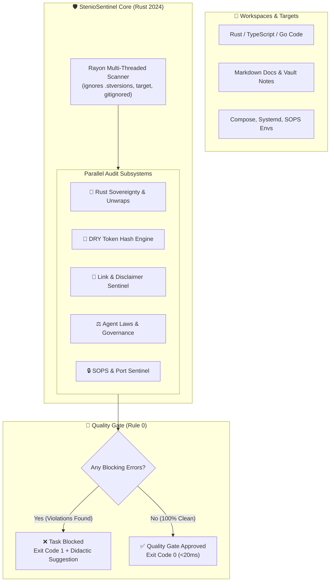

# 🛡️ StenioSentinel (v4.14.0) — High-Performance AI Governance Engine in Rust

[](https://github.com/ceduardorodrig/STENIO-SENTINEL)
[](https://www.rust-lang.org)
[](LICENSE)
[](https://github.com/ceduardorodrig/STENIO-SENTINEL)
[](https://github.com/ceduardorodrig/STENIO-SENTINEL)

> **"Sub-millisecond static governance engine, anti-bypass quality gate, and architectural integrity sentinel for AI coding agents written in Rust 2024."**

---

## 📑 Table of Contents

- 🎯 [Overview & Purpose](#-overview--purpose)
- 🧠 [The AI Coding Problem (Why StenioSentinel?)](#-the-ai-coding-problem-why-steniosentinel)
- ⚡ [Key Capabilities (v4.18.0 Superpowers)](#-key-capabilities)
- 📐 [Architecture Diagram](#-architecture-diagram)
- 🚀 [Installation & Quick Start](#-installation--quick-start)
- 🛠️ [CLI Command Reference](#️-cli-command-reference)
- 🔍 [Built-in Rule Catalog & Scopes](#-built-in-rule-catalog--scopes)
- 🗺️ [Roadmap (v4.0.0 Migration)](ROADMAP.md)
- 📜 [License](#-license)
- 📬 [Author & Community](#-author--community)

---

## 🎯 Overview & Purpose

**StenioSentinel** is a deterministic, ultra-fast static analysis engine, live container inspector, relational schema auditor, and architectural governance sentinel developed in pure **Rust 2024**. 

Built to pair with autonomous AI agents (Claude Code, Gemini CLI, Cursor, Codex, OpenCode, and local LLMs), StenioSentinel acts as an unyielding **Quality Gate (Rule 0)**. It enforces architectural sovereignty, catches silent bypasses, validates documentation integrity, prevents runtime panic risks, and eliminates code duplication — scanning thousands of files in under **10 to 200 milliseconds**.

---

## ⚡ Key Capabilities (v4.14.0 Superpowers)

### 1. Sub-Millisecond Multi-Threaded Engine
Leveraging Rayon and the memory-mapped `ignore` walker, StenioSentinel traverses directories concurrently while honoring `.gitignore` and Syncthing `.stignore` rules. Full audits complete in **1ms to 200ms**.

### 2. Knowledge Graph Engine (`--graph`, `--graph-orphans`)
Constructs a directed graph of all Markdown documents and cross-links via `petgraph`. Computes network density, cyclic clusters (Tarjan's SCC), top referenced knowledge hubs, unreferenced orphan notes, and exports Graphviz DOT topologies (`--graph-dot`).

### 3. Docker Live Drift Inspector (`--docker`)
Connects directly to the local Docker socket (`/var/run/docker.sock`) via `bollard` in **19ms**. Inspects container exit states (catches dead/exited containers with error codes) and alerts on insecure `0.0.0.0` wildcard port exposures vs. loopback/Tailscale binds.

### 4. Native MCP SSE Network Server (`--mcp-sse`)
Built on `axum` and `tokio`, exposes a local Model Context Protocol (MCP) server over Server-Sent Events (SSE) and JSON-RPC 2.0 (`/sse`, `/message`, `/health`). Allows OpenCode, Claude Code, and remote agents on the Tailnet to invoke all 10 Stenio tools remotely without personal API keys.

### 5. Local Offline Semantic Search (`--semantic`)
Pure Rust in-memory TF-IDF vectorizer and cosine similarity ranking (<250ms). Answers natural language queries over the entire vault/codebase offline, with zero external API calls, zero token costs, and zero cloud leaks.

### 6. Mandatory Quality Gate & Anti-Bypass (Rule 0)
Rule 0 enforces that no AI agent can claim task completion without passing Stênio's static verification. Unhandled unwraps, skipped tests, and suppressed linter flags are treated as critical blocking failures.

### 7. Interactive Didactic Remediation (`--explain`)
Whenever a rule violation occurs, agents and developers can execute:
```bash
stenio --explain <RULE_ID>
```
Stênio prints the rule's rationale, bad code examples, good code examples, and the exact remediation recipe.

### 8. Tailscale Mesh & Homelab Observability (`--mesh`, `--health`)
Performs concurrent asynchronous socket probes across distributed infrastructure nodes (Tailscale / WireGuard) in under **30ms to 100ms**, delivering instant health telemetry of NVMe storage, RAM, and GPU accelerators (NVIDIA RTX).
```bash
stenio --explain <RULE_ID>
```
Stênio prints the rule's rationale, bad code examples, good code examples, and the exact remediation recipe.

### 4. Surgical Auto-Fixing (`--fix`)
Fixes common formatting issues, tag discrepancies, and syntax divergences atomically on disk without manual intervention.

### 5. Tailscale Mesh & Homelab Observability (`--mesh`, `--health`)
Performs concurrent asynchronous socket probes across distributed infrastructure nodes (Tailscale / WireGuard) in under **30ms to 100ms**, delivering instant health telemetry of NVMe storage, RAM, and GPU accelerators (NVIDIA RTX).

---

## 📐 Architecture Diagram



---

## 🚀 Installation & Quick Start

### Build from Source (Cargo)

Ensure you have Rust 1.85+ installed (Rust 2024 edition compatible):

```bash
# Clone the repository
git clone https://github.com/ceduardorodrig/STENIO-SENTINEL.git
cd STENIO-SENTINEL

# Build optimized release binary
cargo build --release

# Install to user PATH
cp target/release/stenio ~/.cargo/bin/
```

### Quick Run

```bash
# Run contextual audit on current directory
stenio

# Audit specific directory or repository
stenio --path /path/to/project

# Run git diff staged audit (pre-commit hook)
stenio --diff

# Explain any rule
stenio --explain DOC-VIBE-DISCLAIMER
```

---

## 🛠️ CLI Command Reference

```text
StenioSentinel v4.14.0 — Universal AI Governance & Static Sentinel

Usage: stenio [OPTIONS]

Options:
      --path <PATH>          Target directory to scan [default: .]
      --scope <SCOPE>        Audit scope: [hub, homelab, vault, doc, cv, all]
      --rule <RULE_ID>       Execute only a specific rule by ID
      --diff [<REF>]         Audit only files modified relative to git ref (e.g., HEAD~1 or staged)
      --fix                  Apply automatic surgical repairs to violations
      --fast                 Fast mode (skip deep cross-linking and token hash checks)
      --clean                Sanitize debug artifacts, leftover test files, and reclaim disk
      --mesh                 Concurrent socket probe across Tailscale network nodes
      --health               Full-spectrum system diagnostic (NVMe, RAM, GPU, services)
      --graph                Audit knowledge graph topology (nodes, edges, hubs, density)
      --graph-orphans        List all unreferenced orphan documents in the vault
      --graph-dot            Export the vault knowledge graph in Graphviz DOT format
      --docker               Audit live Docker containers, failed services, and wildcard binds (bollard)
      --mcp-sse              Run Model Context Protocol HTTP Server-Sent Events daemon
      --mcp-host <HOST>      Host IP for MCP SSE server [default: 0.0.0.0]
      --mcp-port <PORT>      Port for MCP SSE server [default: 9099]
      --semantic <QUERY>     Local offline semantic search over vault documents (TF-IDF vectorizer)
      --top-k <N>            Number of top semantic matches to return [default: 5]
      --typegen              Generate TypeScript types from Rust DTO structs
      --explain <RULE_ID>    Explain why a rule exists with bad/good examples
      --self-test            Run built-in synthetic rule integrity tests
      --history              Also scan `git log -p --all` of --path for credential shapes (default off)
  -h, --help                 Print help
  -V, --version              Print version
```

---

### Frappe release flow (v4.15.0)

Configured by the `[frappe]` table of the app's `steniocheck.toml` (no project name in the engine; `--config <file>` overrides).

- `stenio --scope frappe [--path <app root>]`: the nine rules above.
- `stenio pre-release --repo <app root> --tag vX [--prev vY] [--after-build] [--tagged]`: frappe, fork and custom-rule scopes in parallel, `__version__` = tag, tag unused (or at HEAD with `--tagged`), clean tree, HEAD = origin/main, FULL/TEXT-ONLY classification (fail-safe FULL), new msgids translated and cased, no credential shape in the diff, Dockerfile `APP_REF`, built image `.built-from`.
- `stenio --backlog --next-id <HB|SB|MB|GB>`: next free id counting the active file and the archive; `stenio backlog --fix` adds missing ids to the `pending:` frontmatter (DOC-BACKLOG-DRIFT) without touching other keys (v4.16.0). Since v4.18.0 the documented subcommand form (`stenio backlog --next-id GB`) defaults `--path` to the vault root found from the working directory (else the standard vault), so it works from any directory (GB-031).
- `stenio opportunity add --title '<RULE-ID>' --evidence ... --desired ... --acceptance ... [--origin 'agent, harness'] [--priority 🟠] [--ref <doc>] [--path <vault>] [--dry-run]`: the one command every agent uses to log a Stenio opportunity. Allocates the next `GB-` id and refuses a title that is already open; inserts the formatted row after the last `GB` row of `governance/backlog.md` (read, insert one line, guarded write; refused if the file changed meanwhile; no `.bak`), adds the id to `pending:` of the `--ref` document (default `governance/stenio-troubleshooting.md`), runs the backlog audit and prints the id (v4.17.0).
- `stenio verify-host --host H --config <toml> --repo-root <dir>`: `[[parity.files]]` (host, path, repo) compared by sha256 over ssh (PASS/FAIL/DRIFT with both hashes) plus restart policies of all containers (v4.16.0). With `[parity] stenio_container = "<name>"` it also compares the engine version inside that container with the local binary and fails on DRIFT (v4.18.0, GB-030).
- `stenio verify-release --host H --tag T [--project-dir D] [--repo R] [--public-url https://…] [--repo-compose F] [--host-compose F] [--protected-record 'DocType:name:modified'] [--expect-main]`: read-only post-deploy checks over ssh from a fixed command allowlist; one PASS/FAIL/WARN line each, exit 1 on any FAIL. Since v4.18.0 it prints two backup lines: `backup-age` (newest `bench backup`) and `backup-age-scheduled` (newest dump matched by `[frappe] scheduled_backup_glob`, limit `scheduled_backup_max_age_hours`, default 26 h), so a fresh manual backup never masks a stopped timer (GB-032). Since v4.26.0 it also compares two artifacts nobody was comparing: `host-name` reads `host_name` from the site's `site_config.json` (through the backend container) and FAILs naming both values when it is not the declared public URL — `--public-url`, else `[frappe] public_url`, else WARN: the engine does not know the Funnel and never invents a host (GB-127); and `compose-parity` compares the environment **keys** of the repository compose (`--repo-compose`, default `<repo>/compose/frappe/compose.yml` then `<repo>/../miracena-infra/compose/frappe/compose.yml`) with the host's (`--host-compose`, default `<project-dir>/compose.yml`), naming at most 10 keys per side, values never compared (GB-096).
- `stenio release-engine --tag vX [--repo .] [--host kuaray] [--container miracena-stenio] [--compose-dir /srv/data/miracena] [--service stenio] [--image-repo ghcr.io/ceduardorodrig/stenio-sentinel] [--wait-secs N] [--build-timeout-secs N] [--install-dir D] [--skip-ci] [--dry-run]`: the release pass from tag to both hosts — local tag at HEAD, tag pushed to origin, the three GitHub runs (`gh run list`, waits), `cargo build --release --locked`, install with a rollback copy `stenio.prev-<old>`, kuaray image retag/pull (exact version, retagged to the moving major the compose file references)/`compose up`, container version parity, `--self-test` and the `vault`/`homelab` scopes; one PASS/FAIL/SKIP line per step, exit 1 on any FAIL (v4.18.0, GB-034; the major retag since v4.18.1).
- MCP: `stenio_pre_release`, `stenio_verify_release` and `stenio_verify_host` are tools of the MCP server (stdio and `--mcp-sse`), so an agent on any harness calls them instead of shelling out; arguments are validated and run as an argv vector, and the tool returns the exit code plus the PASS/FAIL lines (v4.18.0, GB-022).

## 🔍 Built-in Rule Catalog & Scopes

| Rule ID | Category | Severity | Description |
|---|:---:|:---:|---|
| `RUST-NO-UNWRAP` | Rust | **ERROR** | Strictly forbids `.unwrap()` and `.expect()` in production code. |
| `ARCH-NO-PYTHON` | Arch | **ERROR** | Enforces 100% native Rust backend sovereignty (ADR-036). |
| `ARCH-DRY-DUPLICATION` | Code | **ERROR/WARN** | Two-layer detection with adaptive severity: substantial logic duplication → ERROR; low-density or short structural matches → WARN. |
| `DOC-VIBE-DISCLAIMER` | Docs | **ERROR** | Enforces the standardized human-AI governance disclaimer across all repositories. |
| `DOC-BACKLOG-DRIFT` | Docs | **ERROR/WARN** | Backlog traceability: the active queue (`mnemocine/backlog.md`) and each document's `pending:` frontmatter must agree bidirectionally. Adaptive severity — a drift on a 🔴 item blocks; any other drift warns. |
| `DOC-BACKLOG-QUEUE-PARITY` | Docs | **ERROR** | The `## 2. Queues` table of `governance/backlog-method.md` and the embedded registry (`backlog-queues.toml`) must agree queue by queue: same queues, same prefixes, the label must be the registry `name` and `Location` must resolve to its `dir`. Silent when the document or the table is absent (hub/product repos). Born from GB-066, where the table said "SUMÆNIMÁ Hub" while the TOML said `hub`. |
| `I18N-PO-INCOMPLETE` | i18n | **ERROR** | Gettext catalogues (`locale/*.po`) must be complete: no empty or fuzzy `msgstr` (plural forms included), every static string passed to `_()`, `__()`, `_lt()` or `` in the sources next to the catalogue must be a `msgid` (with its `msgctxt`), and `{0}`, `%s`, `%(name)s` placeholders must match. Tests and vendored code are skipped. No suppression directive exists for it. |
| `FRAPPE-DOCTYPE-CONTROLLER` | Frappe | **ERROR** | Scope `frappe`: every DocType folder with a `.json` has `<name>.py` defining a class and an `__init__.py` (the rc68 migrate break). |
| `FRAPPE-LINK-TITLE` | Frappe | **ERROR** | A Link field whose target DocType in the app has neither `title_field` + `show_title_field_in_link` nor `search_fields`. Core targets are allowlisted. |
| `FRAPPE-PATCH-REGISTERED` | Frappe | **ERROR** | Every `patches/*.py` is in `patches.txt` and every `patches.txt` line resolves to a module. |
| `FRAPPE-HOOK-TARGETS` | Frappe | **ERROR** | Every dotted app path in `hooks.py` resolves to an existing module and function (static lookup). |
| `FRAPPE-TEST-REGISTERED` | Frappe | **ERROR** | Every `tests/*.py` with `run()` is in the test-list section named by `[frappe] test_list_file` / `test_list_anchor`. |
| `FRAPPE-TEST-PARITY` | Frappe | **ERROR** | The pure-test set the `test_list` section declares (`without a site`) and the modules the release battery runs (`names`/`cmds` of `[frappe] battery_file`, else `scripts/release-checks.sh` or the one above the app) must be one set, compared in both directions; unequal arrays, a mislabelled slot and a slot without its file also fail. One side missing → inert WARN that says why. |
| `FRAPPE-SIDEBAR-COVERAGE` | Frappe | **ERROR** | Every non-child DocType is in the sidebar JSON or in the allowlist file (with a reason); every sidebar label has a msgid. |
| `FRAPPE-ROLE-DEFINED` | Frappe | **ERROR** | Every role named in DocType permissions exists in a Role fixture, a patch, or the core list. |
| `FRAPPE-SELECT-CASE` | Frappe | **ERROR** | Select option translations keep the capitalisation pattern of the source. |
| `FRAPPE-WHITELIST-PERMISSION` | Frappe | **WARN** | A `@frappe.whitelist()` function with no permission check. |
| `FRAPPE-DOCTYPE-LABEL-TRANSLATED` | Frappe | **ERROR** | Every label, description, Select option and chart/card label in DocType, sidebar, workspace, number card and dashboard chart JSON has a msgid with a non-empty translation in the app `.po`. |
| `FRAPPE-JSON-MODIFIED-BUMP` | Frappe | **ERROR** | `stenio pre-release --prev`: a changed DocType/Sidebar/Workspace/card/chart/fixture JSON must carry a strictly newer `modified` (Frappe imports only newer files); `[frappe] modified_allowlist` for forced reloads. |
| `FRAPPE-CURRENCY-THRESHOLD-UNSET` | Frappe | **ERROR** | A threshold comparison over a Currency field resolved against the app's DocType JSONs (`(x or 0) >= LIMIT`, `flt(x) >= LIMIT`, the mirrored form, or an attribute read) with no earlier branch for the empty value: Frappe stores an unfilled Currency as 0.0, so an empty value silently reads zero (GB-123/GB-133). A zero-test (`x <= 0`, `x > 0`) and a name that is not Currency are never accused. |
| `FRAPPE-PERMISSION-SCOPE` | Frappe | **ERROR** | A DocType (not a child table, not a Single) with a field that identifies a person — a Link whose `options` is `Member`/`User`, or a fieldname from the person vocabulary — that grants `read`/`write` to a broad role (`Miracena Member`, `Miracena Freelancer`, `Desk User`, `All`, `Guest`) while `hooks.py` registers neither `permission_query_conditions` nor `has_permission` for it. The allowlist is data (`permissions-public.txt` at the root of the app, one DocType per line with the reason after `#`); a missing file is an empty allowlist. `if_owner` does not silence it: the flag narrows one permission row, not the DocType. |
| `I18N-CASE` | i18n | **ERROR** | `.po` pairs: uppercase first letter follows the msgid; Title Case msgids (2 to 6 words) need a Title Case msgstr except small Portuguese words; sentence case is not forced. |
| `AGENT-ENTRYPOINT-RULES` | Agent | **ERROR** (WARN for optional entries) | Every harness entry file listed in `governance/agent-entrypoints.toml` (Claude Code, OpenCode, Antigravity, Hermes) exists and contains its `must_reference` strings (`agent-global-rules.md`, the rituals reminder); `host_only` entries are skipped with INFO on other hosts. Scopes `vault` and `homelab` (v4.17.0). |
| `STENIO-ITEM-FORMAT` | Backlog | **ERROR** | A backlog row titled `Stenio:` must contain `Evidence:`, `Desired behaviour:`, `Acceptance:`, `Origin:` and `Status:` (v4.17.0). |
| `INFRA-COMPOSE-RESTART-POLICY` | Infra | **ERROR** (WARN in the read-only mirror) | Long-running compose services must be `unless-stopped` or `always`; exempt: profiles `cold`/`tunnel`, one-shots awaited with `service_completed_successfully`, label `homelab.restart-exempt`. |
| `DOC-BACKLOG-RECURRENCE` | Docs | **ERROR/WARN** | Backlog recurrence: a `Recurrence` / `Recurred-by` pair must agree — a recurring item points at an *archived* item, and that archived item points back. Adaptive severity. |
| `DOC-UNVERIFIED-INTERFACE` | Docs | **WARN** | A server/service document names a sysfs path, an I2C address or a charger/PMIC chip with no verification marker in the same section. Silenced by `verified\|measured\|implemented\|confirmed\|checked\|read on` plus an ISO date, in the claim's section or in an ancestor heading. Born from GB-007: notes claimed an `axp20x` PMIC with a `voltage_max` knob on a device whose charger is a Summit SMB327. |
| `DOC-STALE-ACCESS-CLAIM` | Docs | **WARN** | A document asserts that a host has no administrative path or access with nothing saying when that was last true. Matches the claim shape only (`no administrative path/access`, `no admin path`, `sem caminho administrativo`), never the ordinary word "unreachable", which is legitimate alert prose. Same date-marker escape as the rule above. |
| `HOMELAB-BACKLOG-STATE` | Homelab | **WARN** | Backlog split: an id must live in exactly one file, and its state must match (a closed state in the queue, an active state in the archive). |
| `HOMELAB-GPU-UNIFIED` | Homelab | **WARN** | GPU unification: a compose service claiming the GPU (`runtime: nvidia`, `gpus:`, `deploy` device reservations or `NVIDIA_VISIBLE_DEVICES`) must be a registered consumer of the centralized gateway (`hl-infer`, ADR-020). The allowlist is a data file (`mnemocine/network/gpu-consumers.txt`) with an engine fallback. |
| `SEC-SECRETS` | Security | **ERROR** | Blocks plain-text credentials by shape in every file type: GitHub tokens (`gh[opsur]_`, `github_pat_`), AWS key ids, Tailscale keys, Google API keys, Slack tokens, GitLab PATs, JWTs, `Authorization: Bearer` headers, SSH/EC/DSA/RSA private-key headers and keyword-anchored passwords. Scans `.env`, `.env.*`, `*.env`, `*.pem`, `*.key` and the phone-synced `.obsidian/*.json` and `.pandoc/*.json`. SOPS ciphertext never fires. |
| `SEC-PLAINTEXT-SECRET` | Security | **ERROR** | Literal credentials in infrastructure files (`*_PASSWORD`, `*_PASS`, `*_PWD`, `*_SECRET`, `*_SECRET_KEY`, `*_API_KEY`, `*_ACCESS_KEY`, `*PRIVATE_KEY`, `*_AUTHKEY`, `*_AUTH_KEY`, `*_CREDENTIALS`, `*_TOKEN`) plus the token shapes; every hit is reported, not one per file. |
| `SEC-PERM-LEAK` | Security | **ERROR** | Secret-bearing files must not be group-writable or reachable by others: `.env`, `*.env`, `*.pem`, `*.key`, `.docker/config.json` (and `secrets.env`, `keys.txt`, SSH keys, which must be 0600). |
| `SEC-SECRETS-HISTORY` | Security | **ERROR** | Opt-in (`--history`): a credential shape added in any commit of `git log -p --all`, even if deleted later. |
| `SEC-SOPS-UNENCRYPTED` | Security | **ERROR** | Prevents committing unencrypted `.enc.*` files; a dotenv is accepted as encrypted with `sops_mac=`/`sops_version=` markers or `ENC[AES256_GCM` values. |
| `GOV-AGENT-LAWS` | Gov | **ERROR** | Validates agent constitution and governance rules in `AGENTS.md`. |
| `VAULT-TAG-TAXONOMY` | Docs | **WARN** | Restricts tags to canonical taxomony cataloged in `_tags.md`. |

---

## 📜 License

Licensed under the **GNU Affero General Public License v3.0 (AGPL-3.0)** — see [LICENSE](LICENSE).

For proprietary integrations, enterprise compliance, or sovereign deployments without copyleft requirements, contact **SUMÆNIMÁ** ([ceduardorodrig@gmail.com](mailto:ceduardorodrig@gmail.com)).

---

## 📬 Author & Community

- **Creator & Maintainer:** **Carlos Eduardo Rodrigues** ([@ceduardorodrig](https://github.com/ceduardorodrig))
- **Portfolio & Profile:** [ceduardorodrig](https://github.com/ceduardorodrig/ceduardorodrig)
- **Venture:** [Sumænimá](https://sumaenima.chimaera-heptatonic.ts.net)

---

<div align="center">

### 🛡️ Human-in-the-Loop Agentic Engineering

Developed by [Carlos Eduardo Rodrigues](https://github.com/ceduardorodrig) with AI coding agents.
Every change is verified by the deterministic quality gate [StenioSentinel](https://github.com/ceduardorodrig/STENIO-SENTINEL).

</div>
